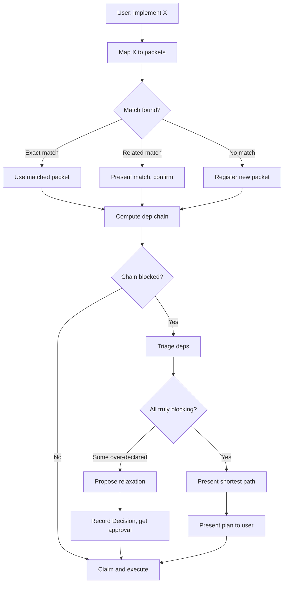
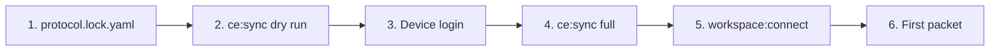

# Spec: User-request intake, dependency triage, fast-track, and project onboarding

**Date:** 2026-11-16
**Author:** droid
**Packet:** CENG-T036-P001
**Status:** Pending user approval

## Problem

When a user says "implement X," the agent faces a gap in the CE protocol:

1. **No structured intake flow.** The agent must manually search packets,
   compute dependency chains, and present options — there is no documented
   procedure, so each agent handles it ad-hoc in chat.

2. **Over-declared dependencies block work unnecessarily.** Packets often
   declare dependencies conservatively (e.g., "depends on the client rollout")
   when the actual code paths don't overlap. The protocol has no formal
   process for evaluating whether a dependency is truly blocking or relaxing
   one that isn't.

3. **No fast-track for user-requested work.** When a user directly requests a
   feature that maps to a blocked packet, the only options are (a) work
   through the entire dependency chain or (b) cancel the blocking packet —
   neither is appropriate when the dependency is over-declared.

4. **No project onboarding procedure.** New projects that want to work under
   CE have no documented fast-path. The device login flow, `ce:sync`,
   `workspace:connect`, and `protocol.lock.yaml` setup are all documented
   individually but not assembled into an onboarding checklist.

5. **No proactive workflow-improvement protocol.** Agents churn out code
   without identifying CE/Task Master edge cases or improvement opportunities
   they encounter during normal work. The skill-evolution skill exists but is
   only triggered at closure — there is no guidance for recording improvements
   discovered mid-packet.

## Design

### 1. User-request intake flow

When a user says "implement X" or "I want feature Y," the agent follows this
procedure:

**Step 1 — Map X to packets.** Search all work-packet YAMLs (including
archived) for title, objective, and scope.in matches against the user's
request. Report:
- Exact matches (packet title/objective directly corresponds)
- Related matches (scope.in overlaps or same task)
- Cancelled matches (with superseding decision reference)
- No match (new packet needed)

**Step 2 — Compute dependency chain.** For the matched packet, recursively
resolve `dependencies` to build the full chain. For each dependency, check
its state: `complete` or `cancelled` = satisfied; any other state = blocking.

**Step 3 — Present shortest-path plan.** If the chain is blocked, present:
- The blocking dependencies and their states
- For each blocking dependency, whether it is truly blocking or
  over-declared (per the triage rules below)
- The shortest path to unblock: either work through truly blocking
  dependencies, relax over-declared ones, or both
- Estimated packet count and effort for each path

The agent presents this as a structured plan, not a question asking the user
to pick shortcuts. The user approves or modifies the plan.

### 2. Dependency triage protocol

A dependency is evaluated as **truly blocking** or **over-declared** using
objective criteria:

**Truly blocking** (any one suffices):
- **Scope overlap:** the dependent packet's `scope.in` files overlap with
  the dependency's `scope.in` files (same file or same directory).
- **Import dependency:** the dependent packet's scope files import or depend
  on a module/interface that the dependency packet creates or modifies.
- **Shared resource lock:** both packets lock the same resource
  (`locks` field overlap).
- **Sequential contract:** the dependency produces a contract, schema, or API
  that the dependent packet consumes (recorded in the dependency's
  acceptance criteria or the dependent packet's `baseline_refs`).

**Over-declared** (all must be true):
- No scope.in file overlap.
- No import dependency (verified by import analysis of the dependent
  packet's scope files).
- No shared resource lock.
- No sequential contract dependency.
- The dependency was declared to sequence work, not because of a technical
  coupling.

**Relaxation process:**
1. The agent records a Decision (`DEC00x`) on the dependent packet with:
   - The relaxed dependency's packet ID
   - The triage result (which criteria were checked, which passed/failed)
   - The rationale for relaxation
   - The risk assessment (what could go wrong if the dependency is not
   completed first)
2. The user approves the Decision.
3. The gate check reads approved Decisions and allows the claim despite the
  dependency not being complete.
4. The relaxation is recorded in the packet's `dependencies` list with an
  optional `dependency_rationale` field pointing to the Decision ID.

**No new packet states.** Relaxation uses existing Decision records and the
existing approval flow. The gate check is extended to consult approved
Decisions that reference a dependency by packet ID and explicitly state
relaxation.

### 3. Fast-track rules for user-requested work

Fast-track applies when **all** of the following are true:
- The user directly requested the work (not agent-discovered).
- The packet maps to the user's request.
- At least one blocking dependency is over-declared per the triage rules.

Fast-track does **not** apply when:
- The dependency is truly blocking (scope overlap, import dependency, shared
  lock, or sequential contract).
- The packet is in a different task than the in-progress workstream and the
  one-workstream rule prevents claiming it.
- The user has not approved the relaxation Decision.

**One-workstream rule interaction:**
- Fast-track does **not** bypass the one-workstream rule. If another task is
  in progress, the user-requested packet's task must wait or the in-progress
  task must be completed/cancelled first.
- Fast-track **does** allow a packet to be claimed out of dependency order
  within its own task's workstream when dependencies are relaxed. This is
  the key mechanism: the one-workstream rule gates cross-task concurrency;
  dependency ordering gates within-task sequencing; fast-track relaxes
  within-task sequencing only.

**Cancelled-packet handling:**
If the user's request maps to a cancelled packet, the agent:
1. Reports the cancellation and references the superseding decision.
2. Proposes the superseding packet (if one exists) or registers a new one.
3. Does not re-open the cancelled packet.

### 4. Project onboarding checklist

A new project can onboard under CE by completing these steps:

1. **Create `protocol.lock.yaml`** in the project repo, pinning the CE
   protocol version and skill hashes. Copy from the CE repo's published lock.

2. **Run `ce:sync --dry-run`** to validate record format and see the link
   report. No token needed for dry run. Fix any format issues.

3. **Complete device login flow.** The project's agent or droid account
   authenticates via the Keycloak device authorization grant (or a stored
   refresh token) to get org-scoped tokens for `ce:sync` and tRPC calls.
   This gates project access: without a valid token, no sync or packet
   operations are possible.

4. **Run `ce:sync`** (full, with token) to import the project's
   `.contract-engineering/` records into Task Master.

5. **Run `workspace:connect`** to start the local agent gateway and write
   `.factory/gateway.json` for MCP facade integration.

6. **Claim the first packet** from the synced backlog.

**Onboarding validation:**
- `ce:sync --dry-run` passes with no format errors.
- A short-lived access token can be minted from the stored refresh token.
- `ce:sync` (full) imports records without errors.
- The board shows the project's packets.
- `workspace:connect` starts the gateway on the configured port.

**Time budget:** A project with existing `.contract-engineering/` records
should onboard in under 30 minutes. A project creating records from scratch
adds the time to write its first task and packets.

### 5. Proactive workflow-improvement protocol

Agents should not just churn out code. During normal packet work, an agent
that encounters a CE or Task Master edge case, missing feature, or improvement
opportunity follows this protocol:

**When to record:**
- A packet state transition fails in an unexpected way that reveals a
  protocol gap.
- A dependency declaration is over-declared (this design's triage rules
  would not have been needed if the protocol guided declaration).
- A UI feature is missing that the agent had to work around (e.g., no
  Approve button on governance records).
- A CE record format or import path has an undocumented edge case.
- The device login flow or token rotation has a failure mode not covered
  in docs.

**How to record:**
1. Do **not** scope-creep the current packet. The improvement is out of
   scope for the packet being worked on.
2. Record a `SkillGap` entry (per the skill-evolution skill) with:
   - `gap_type`: missing, unclear, outdated, or mismatch
   - `severity`: low, medium, or high
   - `description`: what was encountered
   - `impact`: what would improve if this gap were addressed
   - `proposed_change`: what should be added or changed
3. Add the gap to the project's `skill-feedback.md` accumulator.
4. Include the gap ID in the packet handoff under "unresolved items."
5. At task closure, aggregate gaps and present them to the user for
   action/defer/reject decisions.

**When not to record:**
- The issue is trivial (typo, formatting) — fix it directly if in scope.
- The issue is already recorded as a SkillGap — reference the existing ID.
- The issue is specific to the current packet's scope, not a protocol gap.

**Project-level instruction:**
Each consuming project's `AGENTS.md` should include a directive to
proactively identify and record workflow improvements. This is not a CE skill
change — it is a project-level instruction that agents should:
1. Watch for CE/Task Master edge cases during normal work.
2. Record them as SkillGaps without scope-creeping the current packet.
3. Surface them at handoff and closure.

This transforms agents from code generators into workflow improvers: the
agent that encounters a gap records it, the user decides whether to action
it, and the protocol evolves based on real work experience.

## Integration with existing protocol

| Change | Integration point | New states? |
|--------|------------------|-------------|
| Intake flow | Agent procedure in `phased-engineering-execution/SKILL.md` | No |
| Dependency triage | Decision records + gate check extension | No |
| Fast-track | Gate check reads relaxation Decisions | No |
| Onboarding checklist | `project-lifecycle/SKILL.md` + `docs/repository-development.md` | No |
| Proactive improvement | `skill-evolution/SKILL.md` (already has SkillGap) + project `AGENTS.md` | No |

**Packet schema change:** The `dependencies` field entries may optionally
carry a `dependency_rationale` string referencing a Decision ID that
documents why a dependency was relaxed. This is backward-compatible: existing
dependencies are strings (packet IDs); the optional rationale is an
annotation, not a structural change.

## Non-goals

- **No new packet states.** The state machine is unchanged.
- **No new gates.** The Design, Data, and Action Authorization gates are
  unchanged. Dependency relaxation is a Decision, not a gate.
- **No automated dependency analysis tool.** The triage is a manual
  procedure the agent follows, not a tool that runs automatically. A future
  packet could automate it.
- **No multi-task concurrency.** The one-workstream rule is not bypassed.
  Fast-track is within-task only.
- **No GitHub App or hosted server-side sync.** These remain deferred per
  TASKMASTER-T006-P001-DEC001's non-goal.

## Open questions for user review

1. Should the intake flow be documented in `phased-engineering-execution` or
   in a new skill? (Proposed: in `phased-engineering-execution` — it is the
   execution skill and the intake flow is an execution procedure.)

2. Should the onboarding checklist be a doc, a skill section, or both?
   (Proposed: a section in `project-lifecycle/SKILL.md` with a reference in
   `docs/repository-development.md`.)

3. Should the proactive-improvement directive be in each project's
   `AGENTS.md` or in a CE skill? (Proposed: in each project's `AGENTS.md`
   with a reference from `skill-evolution/SKILL.md` clarifying that
   mid-packet gap recording is allowed.)

4. Is 30 minutes a realistic onboarding time budget for projects with
   existing records? (Proposed: yes, if the device login flow works. The
   Keycloak realm device-flow pages currently error, which is a known issue
   — when that's fixed, 30 minutes is achievable.)
